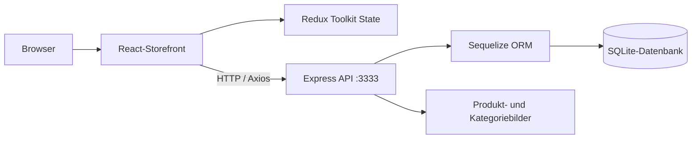

# React Pet Shop — Full-Stack-Onlineshop-Demo

**Eine Produktkatalog- und Warenkorb-Anwendung mit React, Redux Toolkit, Express, Sequelize und SQLite.**

**Sprache:** [English](README.md) · Deutsch · [Bisherige technische Notizen](README.legacy.md)

**Technologien:** React 19 · Create React App · Redux Toolkit · React Router · Axios · Node.js · Express · Sequelize · SQLite

> **Status:** Lokal ausführbares Full-Stack-Portfolio-Projekt. Katalog und Warenkorb sind implementiert; Bestell- und Sale-Endpunkte enthalten Demo-Handler und keine echte Zahlungs- oder Bestellabwicklung. Die eingecheckte SQLite-Datenbank sollte vor einer Weitergabe auf personenbezogene Daten geprüft werden.

## Screenshots

Bereits vorhandene Projektbilder mit relativen Pfaden, die auch nach einer Umbenennung des Repositories funktionieren:


Weitere Bilder: [`Pet-Shop-Frontend/public/docs/`](Pet-Shop-Frontend/public/docs/).

## Funktionen

- Produktkatalog und Kategorien durchsuchen.
- Produktdetails und reduzierte Artikel ansehen.
- Artikel zum Warenkorb hinzufügen, Mengen verändern, Artikel entfernen und Summen berechnen.
- Produktdaten über eine Express-REST-API mit Sequelize und SQLite laden.
- Navigation über React Router.

## Architektur



| Komponente | Verzeichnis |
| --- | --- |
| Frontend / React-Seiten | `Pet-Shop-Frontend/src/pages/` |
| Redux-Store und Feature-Slices | `Pet-Shop-Frontend/src/app/` sowie `src/features/` im Frontend |
| API-Server | `Pet-Shop-Backend/index.js` |
| API-Routen | `Pet-Shop-Backend/routes/` |
| Datenmodelle | `Pet-Shop-Backend/database/models/` |

## Lokal starten

**Voraussetzungen:** Node.js und npm. Backend und Frontend werden in getrennten Terminals gestartet.

**Terminal 1 — Backend:**

```bash
cd Pet-Shop-Backend
npm install
npm run dev
```

API: [http://localhost:3333](http://localhost:3333).

**Terminal 2 — Frontend:**

```bash
cd Pet-Shop-Frontend
npm install
npm start
```

Oberfläche: [http://localhost:3000](http://localhost:3000). Die API-Adresse `http://localhost:3333` ist in den Produkt-/Kategorie-API-Modulen fest eingetragen. Eine Portänderung erfordert eine gesonderte Anpassung.

**Hinweis:** Die Befehle stammen aus vorhandenen `package.json`-Skripten; sie wurden bei der README-Überarbeitung nicht ausgeführt.

## Technische Hinweise und Grenzen

- Sequelize verwaltet die Datenmodelle und synchronisiert die SQLite-Datenbank beim Backend-Start.
- Die REST-Endpunkte liefern Produkt- und Kategoriedaten; der Warenkorbzustand liegt im Frontend.
- Bestellung und Sale sind Demo-Endpunkte; keine echte Zahlung, Auftragsabwicklung oder Benutzerverwaltung.
- Die Backend-CORS-Konfiguration ist für eine lokale Demo großzügig; ein öffentlicher Produktivbetrieb erfordert zusätzliche Absicherung.
- Kein CI-Workflow und keine aussagekräftige Backend-Testsuite festgestellt. Das Backend-Skript `npm test` ist ein Platzhalter.
- Die versionierte Datei `Pet-Shop-Backend/database.sqlite` sollte vor einer externen Weitergabe auf private Daten geprüft werden.

## Demo-Ablauf für Recruiter

Kategorien öffnen → Produktdetails zeigen → Warenkorb befüllen → Menge ändern → dazugehörige Express-Routen und Redux-Zustandsänderungen erläutern.

## Weitere Dokumentation

Frühere technische Beschreibung: [`README.legacy.md`](README.legacy.md). Module: [`Pet-Shop-Frontend/README.md`](Pet-Shop-Frontend/README.md) und [`Pet-Shop-Backend/README.md`](Pet-Shop-Backend/README.md).

*Portfolio-Schwerpunkte: Full-Stack JavaScript, REST-API-Integration, State Management und relationale Datenhaltung.*