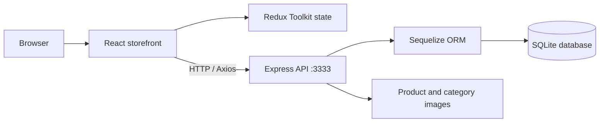

# React Pet Shop — Full-Stack Storefront Demo

**A product-catalog and shopping-cart application built with React, Redux Toolkit, Express, Sequelize and SQLite.**

**Language:** English · [Deutsch](README.de.md) · [Previous technical notes](README.legacy.md)

**Stack:** React 19 · Create React App · Redux Toolkit · React Router · Axios · Node.js · Express · Sequelize · SQLite

> **Status:** Local full-stack portfolio demo. Catalog and cart flows are implemented; the order and sale endpoints contain demonstration handlers rather than real payment/order fulfillment. The included SQLite database should be reviewed for non-demo data before redistributing it.

## Screenshots

Existing images from the repository, linked using paths that also work after repository renaming:


Additional original screenshots are in [`Pet-Shop-Frontend/public/docs/`](Pet-Shop-Frontend/public/docs/).

## Core functionality

- Browse the catalog and product categories.
- View product details and sale-priced items.
- Add products to the cart, increase/decrease quantities, remove items and calculate totals.
- Fetch catalog data from an Express REST API backed by Sequelize and SQLite.
- Navigate the storefront using React Router.

## Architecture



| Component | Location |
| --- | --- |
| Frontend / React pages | `Pet-Shop-Frontend/src/pages/` |
| Redux store and feature slices | `Pet-Shop-Frontend/src/app/`, `src/features/` inside frontend |
| API server | `Pet-Shop-Backend/index.js` |
| Routes | `Pet-Shop-Backend/routes/` |
| Data models | `Pet-Shop-Backend/database/models/` |

## Run locally

**Requirements:** Node.js, npm; dependencies for both applications. Start each process in a separate terminal from the repository root.

**Terminal 1 — API:**

```bash
cd Pet-Shop-Backend
npm install
npm run dev
```

Backend: [http://localhost:3333](http://localhost:3333).

**Terminal 2 — storefront:**

```bash
cd Pet-Shop-Frontend
npm install
npm start
```

Frontend: [http://localhost:3000](http://localhost:3000). The frontend API URL is hardcoded to `http://localhost:3333` in the product/category API modules; changing ports requires a separate code/configuration change.

**Note:** These commands reflect the existing `package.json` scripts and were not executed for this README update.

## Engineering notes and limitations

- The backend uses Sequelize models and synchronizes the SQLite database at startup.
- Product/category REST endpoints support storefront browsing; the cart is managed on the frontend.
- Order and sale endpoints are mock handlers. There is no real checkout, payment provider or user-account flow.
- Backend CORS is configured permissively for local demonstration; the API is not hardened for public deployment.
- No CI workflow or substantive backend test suite was identified. The backend `npm test` script is a placeholder.
- The tracked `Pet-Shop-Backend/database.sqlite` file requires a data/privacy review before presenting it as distributable demo data.

## Suggested reviewer walkthrough

Browse categories → inspect a product → add it to the cart → update quantity → inspect the matching Express routes and Redux state transitions.

## Documentation

Original detailed notes: [`README.legacy.md`](README.legacy.md). Module documentation: [`Pet-Shop-Frontend/README.md`](Pet-Shop-Frontend/README.md) and [`Pet-Shop-Backend/README.md`](Pet-Shop-Backend/README.md).

*Portfolio focus: Full-Stack JavaScript, REST API integration, state management and relational persistence.*